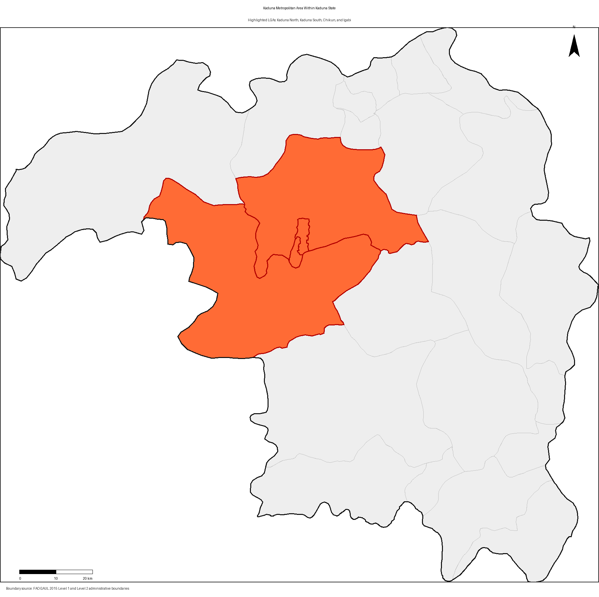
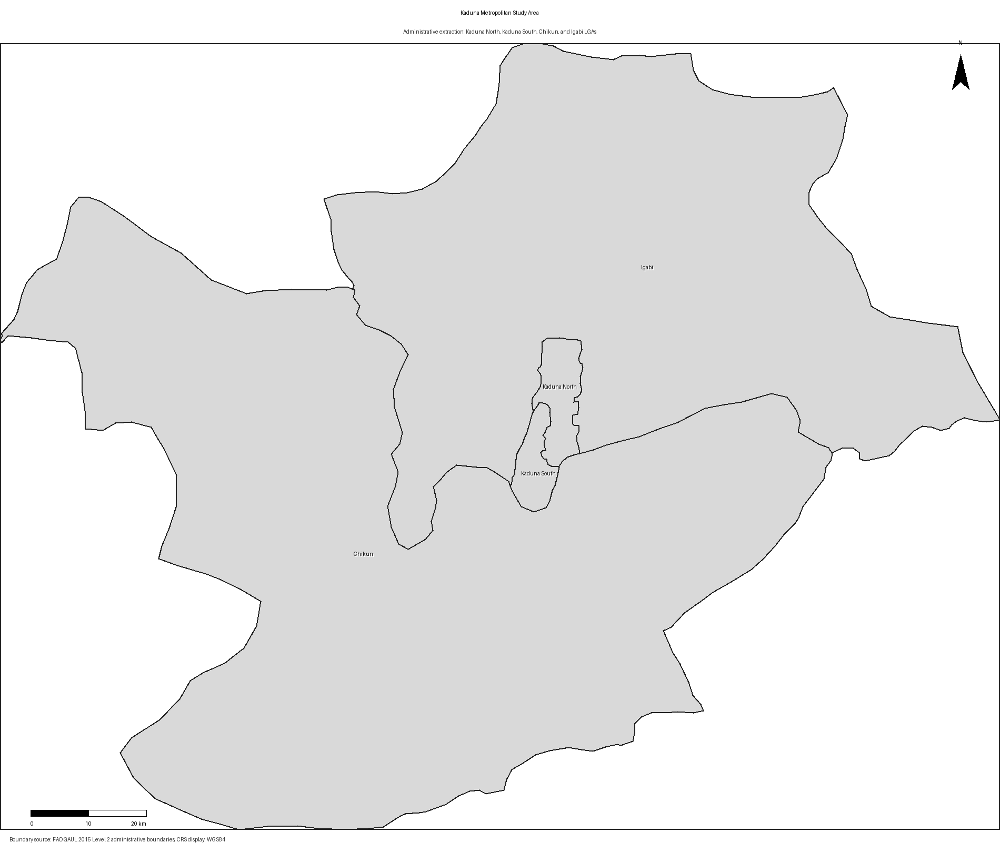
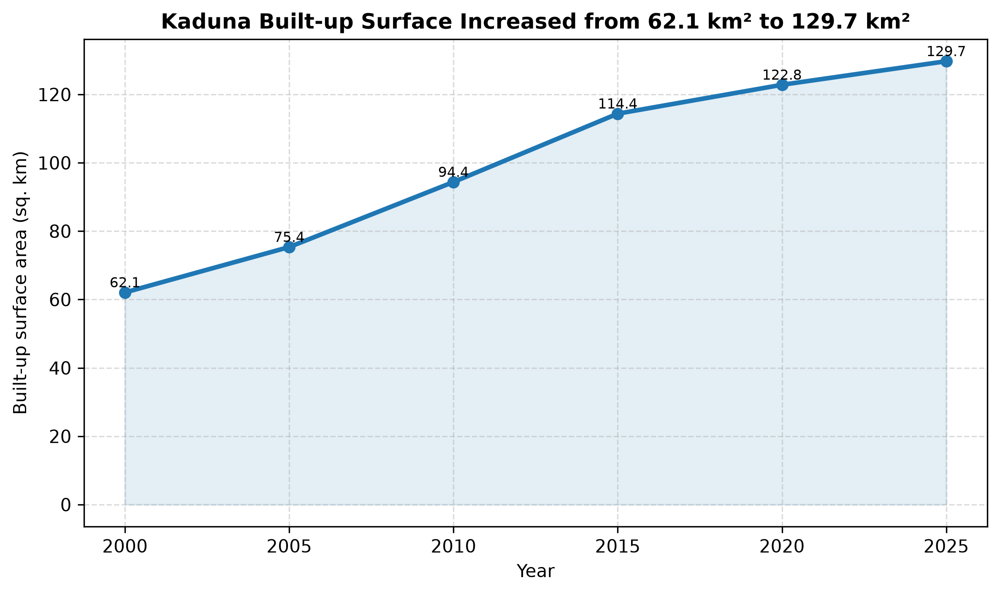
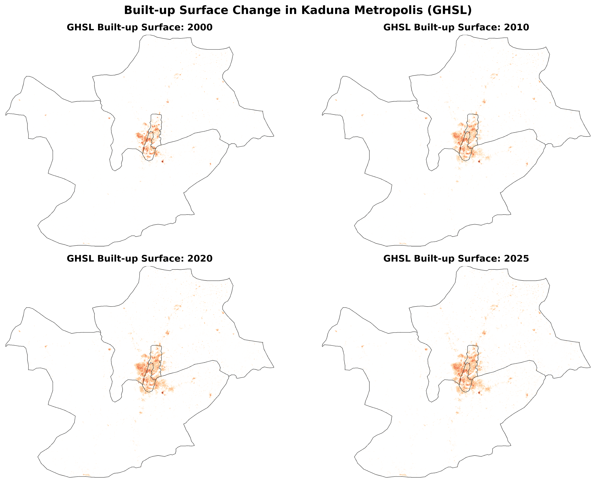
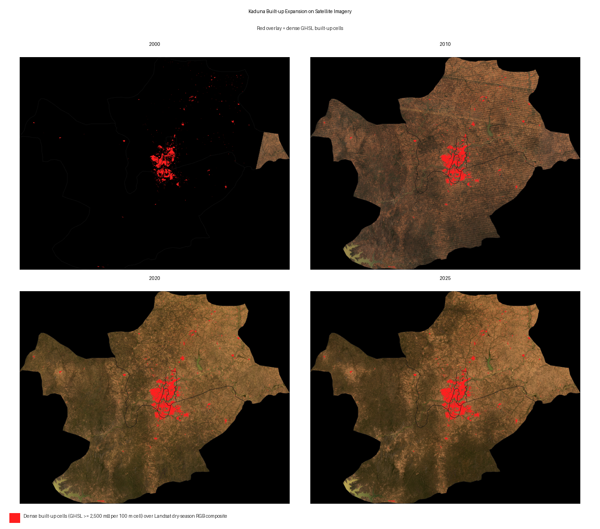
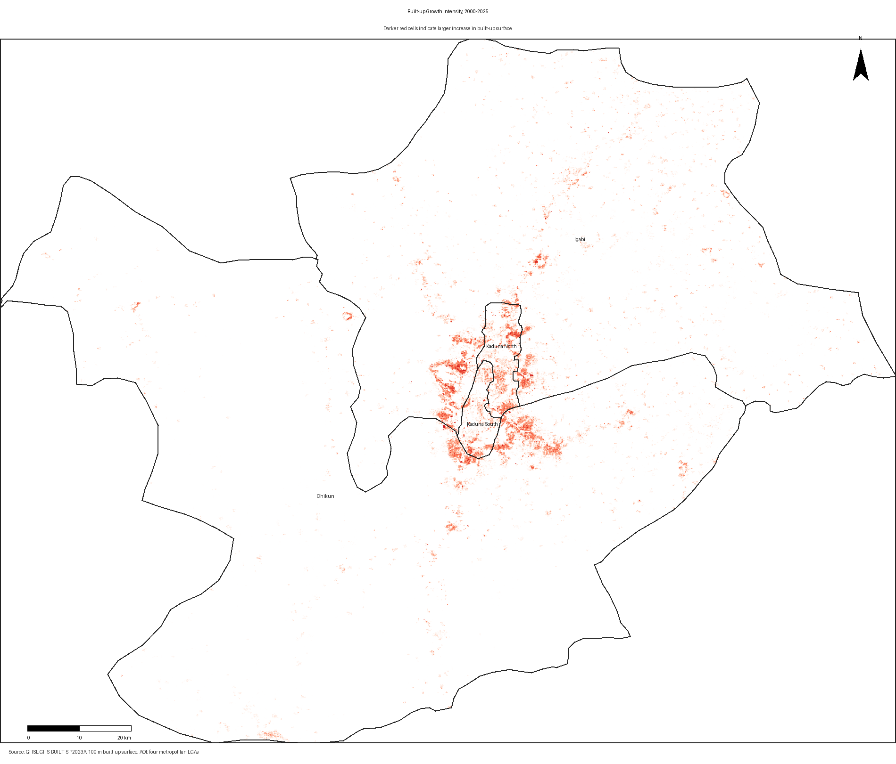
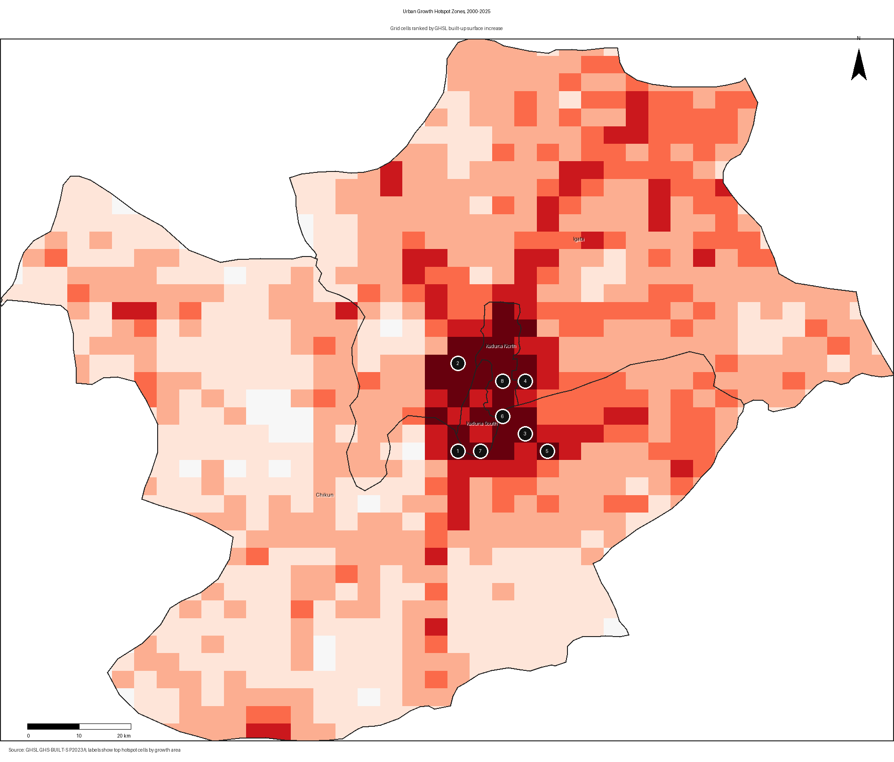
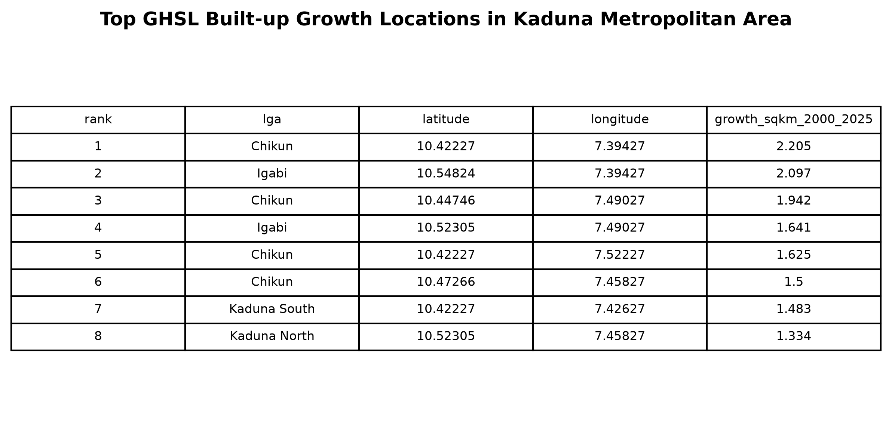
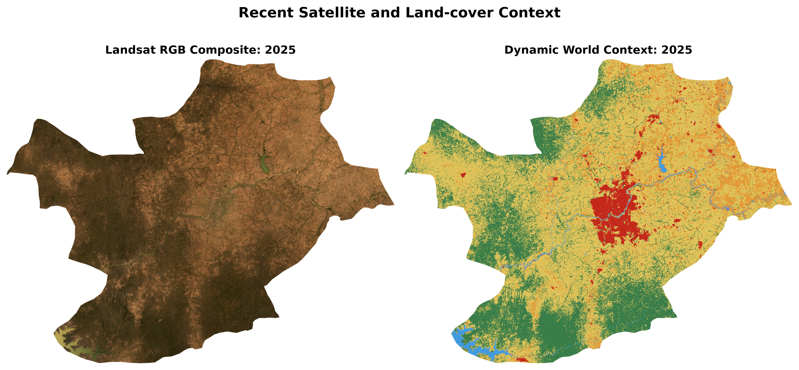

# GeoAI-Based Detection of Urban Growth Hotspots for Climate-Resilient Urban Planning in Kaduna Metropolis, Nigeria

**Author:** Alamin Musa Magaga  
**Affiliation:** YandyTech Community / Nest Africa AI Innovation Lab  
**Country:** Nigeria  
**Email:** alaminmusamagaga@gmail.com  

## Abstract

Rapid urban expansion is reshaping many African cities and increasing pressure on land, infrastructure, drainage systems, green spaces, and public services. In Kaduna Metropolis, Nigeria, climate-resilient urban planning requires timely spatial evidence on where built-up growth is occurring and which locations may need priority planning intervention. This study applies a GeoAI-enabled Earth Observation workflow to detect and visualize urban growth hotspots in Kaduna Metropolis from 2000 to 2025. The metropolitan study area was defined using four administrative Local Government Areas: Kaduna North, Kaduna South, Chikun, and Igabi. Multi-temporal built-up surface estimates were derived from the Global Human Settlement Layer GHS-BUILT-S dataset, while Landsat imagery and Dynamic World land-cover data were used for visual and contextual interpretation. Built-up surface change was quantified for 2000, 2005, 2010, 2015, 2020, and 2025, and a grid-based hotspot analysis was applied to identify cells with the highest built-up surface increase. Results show that built-up surface increased from approximately 62.1 km² in 2000 to 129.7 km² in 2025, indicating that the built-up footprint more than doubled over the 25-year period. The strongest growth cells were concentrated in Chikun, Igabi, Kaduna South, and Kaduna North around the central metropolitan belt. The study demonstrates how open geospatial datasets and reproducible GeoAI workflows can support climate-resilient urban planning by identifying rapidly transforming areas where drainage, infrastructure, housing, green-space protection, and service delivery require proactive attention.

**Keywords:** GeoAI; urban growth; GHSL; Kaduna Metropolis; climate resilience; Earth Observation; built-up surface; hotspot analysis

## 1. Introduction

Urban growth is one of the most visible forms of environmental and socioeconomic transformation in African cities. As cities expand, built-up surfaces replace vegetation, agricultural land, open spaces, and other land-cover types. This transformation can support economic development and housing provision, but unmanaged expansion can also intensify climate-related risks by increasing surface runoff, reducing infiltration, fragmenting green spaces, stressing drainage systems, and placing new settlements in locations where infrastructure and services are insufficient.

Kaduna Metropolis is an important administrative, commercial, educational, industrial, and transport centre in northern Nigeria. Its urban footprint has expanded along the central city, peri-urban areas, and transport corridors. For planners, the important question is not only how much Kaduna has grown, but where growth is concentrated and which locations may require priority investment in climate-resilient infrastructure. Detecting spatial growth hotspots can help support decisions on drainage improvement, transport planning, land-use control, green-space preservation, waste management, and public service expansion.

Geospatial Artificial Intelligence, or GeoAI, provides a practical approach for urban monitoring by combining satellite imagery, large-scale geospatial datasets, spatial analytics, and reproducible computation. In many African cities, up-to-date local planning datasets may be limited, but open Earth Observation products can provide consistent evidence on urban change. This study uses a GeoAI-enabled workflow to detect built-up growth hotspots in Kaduna Metropolis using the Global Human Settlement Layer built-up surface product, Landsat satellite imagery, Dynamic World land-cover context, and grid-based spatial hotspot analysis.

The study is framed around climate-resilient urban planning. Built-up expansion is not automatically a climate risk, but rapid and spatially concentrated growth can increase exposure and vulnerability if it occurs without adequate drainage, transport access, open-space planning, and infrastructure provision. By mapping where built-up growth has been strongest, the study provides evidence that can help identify areas where planning and adaptation action should be prioritized.

## 2. Study Area

The study focuses on Kaduna Metropolis in Kaduna State, Nigeria. Kaduna is a major urban centre in northern Nigeria and serves as the capital of Kaduna State. The metropolitan area includes dense urban neighbourhoods, peri-urban settlements, commercial districts, transport corridors, and expanding residential zones.

For this workflow, Kaduna Metropolis was defined using four Local Government Areas: Kaduna North, Kaduna South, Chikun, and Igabi. Kaduna North and Kaduna South represent the core urban area, while Chikun and Igabi capture much of the surrounding peri-urban expansion zone. This expanded metropolitan boundary is more suitable for urban-growth analysis than using only the two core LGAs because recent expansion often occurs at the urban fringe.

**Figure 1** shows the metropolitan LGAs highlighted within Kaduna State. **Figure 2** verifies the extracted metropolitan study area and labels the four selected LGAs.

## 3. Data and Methods

### 3.1 Data Sources

The study used open geospatial datasets available through Google Earth Engine. The main evidence layer for long-term built-up change was the Global Human Settlement Layer GHS-BUILT-S P2023A product. This dataset provides built-up surface estimates in square metres per grid cell for multiple years, including 2000, 2005, 2010, 2015, 2020, and 2025. It was selected because it provides a consistent multi-temporal built-up surface record and avoids the temporal bias that can occur when a land-cover classifier trained on one reference year is applied backward to earlier imagery.

Landsat Collection 2 Level 2 imagery was used to create dry-season RGB composites for visual interpretation. Landsat 5 and Landsat 7 supported earlier years, while Landsat 8 and Landsat 9 supported more recent years. Dynamic World land-cover data was used as a 2025 contextual layer to support interpretation of recent land-cover patterns. FAO GAUL administrative boundaries were used to extract Kaduna State and the four metropolitan LGAs.

### 3.2 Workflow Overview

The workflow followed six main steps:

1. Extract Kaduna State and the four metropolitan LGAs from FAO GAUL administrative boundaries.
2. Derive GHSL built-up surface estimates for 2000, 2005, 2010, 2015, 2020, and 2025.
3. Calculate built-up surface area for each year within the metropolitan boundary.
4. Map built-up growth intensity by subtracting the 2000 built-up surface from the 2025 built-up surface.
5. Create a grid over the study area and calculate built-up surface growth within each grid cell.
6. Rank grid cells by growth intensity and map the highest urban growth hotspots with LGA names and coordinates.

### 3.3 Built-Up Surface Change Calculation

For each selected year, the GHSL built-up surface image was clipped to the metropolitan boundary. Built-up surface area was calculated by summing built-up surface values and converting square metres to square kilometres. Change between successive time steps was calculated as the difference in built-up surface area, while percentage change was calculated relative to the previous observation year.

The main built-up growth layer was calculated as:

**Growth 2000-2025 = Built-up surface 2025 - Built-up surface 2000**

Negative values were set to zero to focus on built-up expansion rather than apparent reductions or dataset noise.

### 3.4 Hotspot Analysis

The study area was divided into a regular grid. For each grid cell, the total built-up surface increase from 2000 to 2025 was calculated. Grid cells were then ranked by growth area. The highest-ranked cells represent zones where built-up expansion was most concentrated. Coordinates were derived from grid-cell centroids, and each hotspot cell was assigned to an LGA using its spatial intersection with the metropolitan administrative boundaries.

This approach is planning-oriented. It does not claim that each hotspot is a statistically significant cluster in the strict inferential sense, but it identifies spatial units with the highest observed built-up surface growth and makes them visible for interpretation and planning discussion.

### 3.5 Visual QA and Methodological Correction

An earlier Random Forest LULC experiment trained using a 2020 land-cover reference layer produced unrealistic historical built-up estimates when applied backward to 2000 and 2005 Landsat imagery. Specifically, it suggested a large built-up decline over time, which contradicted the expected urban-growth pattern and visual evidence. For this reason, the final publication workflow uses GHSL built-up surface as the primary evidence layer for long-term built-up expansion. Landsat and Dynamic World are used as supporting visual and contextual datasets rather than as the primary source of multi-year built-up area estimates.

This correction is important because publication-grade GeoAI analysis must include plausibility checks, not only automated classification outputs. If a model produces a physically or historically implausible urban trend, the workflow must be revised before interpretation.

### 3.6 Spatial Driver Context Analysis

To support interpretation of the urban growth hotspots, selected spatial context layers were overlaid with the built-up growth results. These included major roads, the baseline 2000 built-up core, river and water features, and metropolitan LGA boundaries. The purpose of this step was to identify spatial associations that may help explain the observed pattern of urban expansion, rather than to establish causal relationships.

Major roads were used to assess whether high-growth cells appear to align with accessibility corridors. The 2000 built-up core was used to distinguish expansion around older developed areas from more peripheral growth. River and water features were included to support climate-resilience interpretation, especially in relation to runoff, drainage, and environmental management. LGA boundaries were used to connect hotspot locations to administrative planning responsibilities.

For each top-ranked hotspot cell, distance metrics were calculated, including distance to the nearest major road, distance to the 2000 built-up core, and distance to river or water features. These metrics were used to support planning-oriented interpretation of the hotspot results.

## 4. Results

### 4.1 Built-Up Surface Growth from 2000 to 2025

The GHSL results show a clear increase in built-up surface within Kaduna Metropolis. Built-up surface increased from approximately 62.1 km² in 2000 to 129.7 km² in 2025. This means that the built-up footprint more than doubled over the 25-year period.

The largest absolute increases occurred between 2010 and 2015, when built-up surface increased by approximately 20.0 km², and between 2005 and 2010, when it increased by approximately 19.0 km². Growth continued after 2015, but the rate of increase was lower between 2020 and 2025.

**Table 1. GHSL built-up surface statistics for Kaduna Metropolis.**

| Year | Built-up surface (km²) | Change (km²) | Percentage change |
|---:|---:|---:|---:|
| 2000 | 62.1 | - | - |
| 2005 | 75.4 | 13.3 | 21.4% |
| 2010 | 94.4 | 19.0 | 25.2% |
| 2015 | 114.4 | 20.0 | 21.2% |
| 2020 | 122.8 | 8.4 | 7.4% |
| 2025 | 129.7 | 6.9 | 5.6% |

**Figure 3** shows the built-up surface trend from 2000 to 2025.

### 4.2 Multi-Year Built-Up Surface Pattern

The multi-year GHSL map panel shows a persistent concentration of built-up surface around the central metropolitan area, with expansion radiating outward over time. The 2000 map shows a smaller and more compact built-up footprint, while the 2010, 2020, and 2025 maps show progressive expansion around the central urban belt.

**Figure 4** presents the multi-year built-up surface panel.

### 4.3 Satellite Evidence of Urban Expansion

The Landsat and GHSL overlay panel provides visual context for the built-up expansion pattern. Dense built-up cells are shown in red over Landsat dry-season RGB composites for 2000, 2010, 2020, and 2025. The panel helps viewers compare the built-up footprint over time and see how the urban core and surrounding settlement areas expanded.

The 2000 satellite composite is visually darker than later years because fewer suitable dry-season Landsat observations were available and older sensors provide less visually clean imagery. However, it remains useful as a baseline context layer when interpreted together with GHSL built-up surface data.

### 4.4 Built-Up Growth Intensity

The built-up growth intensity map shows where built-up surface increased most strongly between 2000 and 2025. Growth is concentrated around the central metropolitan belt and adjacent expansion zones. This pattern suggests that Kaduna's expansion is not evenly distributed across the four LGAs. Instead, growth is spatially clustered around areas connected to the existing urban core and surrounding development corridors.

### 4.5 Urban Growth Hotspots

The hotspot map ranks grid cells by built-up surface increase. The most prominent hotspot cells are located around the central metropolitan area and nearby expansion zones in Chikun, Igabi, Kaduna South, and Kaduna North. The hotspot numbering helps link mapped locations to the coordinate table.

The top-ranked hotspot cells are shown in Table 2. These coordinates represent grid-cell centroids and should be interpreted as approximate hotspot locations rather than exact development parcels.

**Table 2. Top GHSL built-up growth locations in Kaduna Metropolis.**

| Rank | LGA | Latitude | Longitude | Growth 2000-2025 (km²) |
|---:|---|---:|---:|---:|
| 1 | Chikun | 10.42227 | 7.39427 | 2.205 |
| 2 | Igabi | 10.54824 | 7.39427 | 2.097 |
| 3 | Chikun | 10.44746 | 7.49027 | 1.942 |
| 4 | Igabi | 10.52305 | 7.49027 | 1.641 |
| 5 | Chikun | 10.42227 | 7.52227 | 1.625 |
| 6 | Chikun | 10.47266 | 7.45827 | 1.500 |
| 7 | Kaduna South | 10.42227 | 7.42627 | 1.483 |
| 8 | Kaduna North | 10.52305 | 7.45827 | 1.334 |
| 9 | Kaduna North | 10.49785 | 7.45827 | 1.299 |
| 10 | Chikun | 10.47266 | 7.49027 | 1.249 |
| 11 | Igabi | 10.54824 | 7.49027 | 1.227 |
| 12 | Igabi | 10.49785 | 7.39427 | 1.223 |

### 4.6 Recent Land-Cover Context

The 2025 Landsat and Dynamic World context map provides a recent view of the study area. The Landsat RGB composite gives visual satellite context, while Dynamic World provides an independent land-cover classification context for 2025. This figure is not used as the primary basis for the long-term built-up trend, but it supports interpretation of the current landscape.

### 4.7 Spatial Factors Associated with Urban Growth Hotspots

The spatial driver overlay shows that Kaduna's strongest growth hotspots are concentrated around the central metropolitan belt and nearby peri-urban expansion zones. Several high-growth cells occur close to the 2000 built-up core, suggesting edge expansion and consolidation around the established urban footprint. Other high-growth cells extend into Chikun and Igabi, indicating outward peri-urban expansion beyond the older core LGAs.

The overlay with major roads suggests that accessibility corridors may be associated with some of the observed growth patterns. This is especially relevant for interpreting expansion from the central city into surrounding development zones. River and water features provide an additional climate-resilience context, as growth near drainage-sensitive landscapes may require closer attention to runoff management, open-space protection, and infrastructure planning.

These relationships should be interpreted as exploratory spatial associations, not causal evidence. However, they provide a useful basis for identifying priority zones for field validation, infrastructure assessment, drainage planning, and urban growth management.

## 5. Discussion

### 5.1 Interpretation of Urban Expansion

The results indicate substantial built-up surface expansion in Kaduna Metropolis between 2000 and 2025, including central-core expansion, peri-urban growth in Chikun and Igabi, and possible corridor-linked development patterns. The increase from 62.1 km² to 129.7 km² suggests a major transformation of the urban footprint. The spatial pattern of growth shows concentration around the central metropolitan belt, with important hotspot cells in Chikun, Igabi, Kaduna South, and Kaduna North.

This pattern is consistent with the idea that metropolitan growth extends beyond the formal core city into peri-urban LGAs. Chikun and Igabi are especially important because they capture much of the fringe expansion surrounding the core urban area. The presence of high-growth cells in Kaduna South and Kaduna North also shows that urban transformation remains active within and around the central built-up area.

### 5.2 Relevance to Climate-Resilient Urban Planning

The study is relevant to climate-resilient planning because built-up expansion changes the physical surface of the city. Increasing impervious surfaces can increase runoff, reduce infiltration, intensify local heat exposure, and increase pressure on drainage networks. When growth is concentrated in specific zones, those zones may require targeted planning attention.

The hotspot results can support climate-resilient planning in several ways. First, they can help identify areas where drainage infrastructure should be assessed or upgraded. Second, they can guide decisions on where green spaces and open land should be protected to reduce heat and runoff. Third, they can support infrastructure planning by highlighting where roads, water supply, waste management, and public services may face increasing demand. Fourth, the maps can support zoning and development control by showing where urban growth pressure is strongest.

In this sense, the study does not treat urban expansion only as a land-cover change problem. It treats urban growth as a planning signal that can help identify where adaptation, infrastructure, and environmental management may be most urgent.

### 5.3 Importance of Dataset Choice and Validation

The workflow also demonstrates an important methodological lesson for GeoAI research. An earlier Random Forest land-cover classification workflow produced implausible historical built-up estimates when 2020 reference labels were used to classify earlier Landsat imagery. This shows that high automation does not guarantee reliable historical interpretation. In multi-temporal urban studies, models must be checked against independent data, visual evidence, and expected urban-growth logic.

Using GHSL built-up surface as the primary long-term evidence layer improved the reliability of the results because it provides a consistent built-up product across multiple time steps. Landsat and Dynamic World remain useful, but in this workflow they are used for visual and contextual support rather than as the sole basis for long-term built-up area estimation.

### 5.4 Planning Implications

The results suggest several planning implications for Kaduna Metropolis. The strongest growth zones should be considered priority areas for infrastructure assessment. Chikun and Igabi are particularly important because they contain several high-growth grid cells and represent peri-urban expansion zones. Kaduna North and Kaduna South remain important because they contain the urban core and still show major growth locations.

Planning authorities can use the hotspot maps and coordinate table to guide field verification, infrastructure audits, drainage planning, and land-use monitoring. The workflow can also support regular monitoring if updated with future GHSL, Landsat, Sentinel, or other Earth Observation datasets.

## 6. Limitations

This study has limitations. First, GHSL provides built-up surface estimates at a generalized spatial resolution and may not capture all small buildings or fine-scale local changes. Second, the hotspot grid and spatial driver layers identify exploratory spatial associations with roads, baseline built-up areas, and river or water features, but they do not prove socioeconomic, policy, or causal drivers of growth. Third, coordinates in the hotspot table represent grid-cell centroids and should not be interpreted as exact parcel locations. Fourth, the satellite imagery is used for visual context and may vary in quality across years due to sensor differences, cloud conditions, and seasonal effects.

Despite these limitations, the workflow provides a transparent and reproducible method for detecting urban growth hotspots using open datasets. It is suitable for workshop presentation, preliminary academic reporting, and planning-oriented discussion, while future work can improve local validation and driver analysis.

## 7. Conclusion

This study applied a GeoAI-enabled Earth Observation workflow to detect urban growth hotspots in Kaduna Metropolis, Nigeria. Using GHSL built-up surface data, the study found that built-up surface increased from approximately 62.1 km² in 2000 to 129.7 km² in 2025. Growth was spatially concentrated around the central metropolitan belt, with top hotspot cells located in Chikun, Igabi, Kaduna South, and Kaduna North.

The study contributes a practical and replicable workflow for climate-resilient urban planning in African cities. By identifying where built-up growth is strongest, the approach can help planners prioritize drainage, infrastructure, green-space protection, service delivery, and field validation. The work also shows the importance of visual QA and methodological correction in GeoAI studies: model outputs must be checked for plausibility before being used as planning evidence.

Future work should incorporate field validation, higher-resolution building datasets, road-network analysis, population exposure, flood-risk layers, heat-risk indicators, and socioeconomic drivers of expansion. These additions would strengthen the connection between urban growth detection and climate-resilient planning decisions.

## References

European Commission, Joint Research Centre. Global Human Settlement Layer GHS-BUILT-S P2023A. Available through Google Earth Engine: `JRC/GHSL/P2023A/GHS_BUILT_S`.

Google and World Resources Institute. Dynamic World V1. Available through Google Earth Engine: `GOOGLE/DYNAMICWORLD/V1`.

United States Geological Survey. Landsat Collection 2 Level 2 Surface Reflectance products. Available through Google Earth Engine.

Food and Agriculture Organization of the United Nations. GAUL 2015 administrative boundaries. Available through Google Earth Engine: `FAO/GAUL/2015/level1` and `FAO/GAUL/2015/level2`.

European Space Agency. ESA WorldCover 2020. Available through Google Earth Engine: `ESA/WorldCover/v100/2020`.

